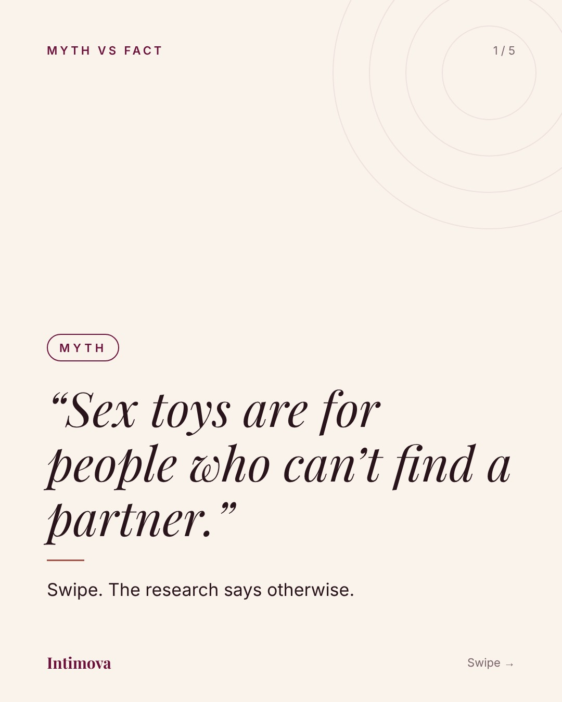
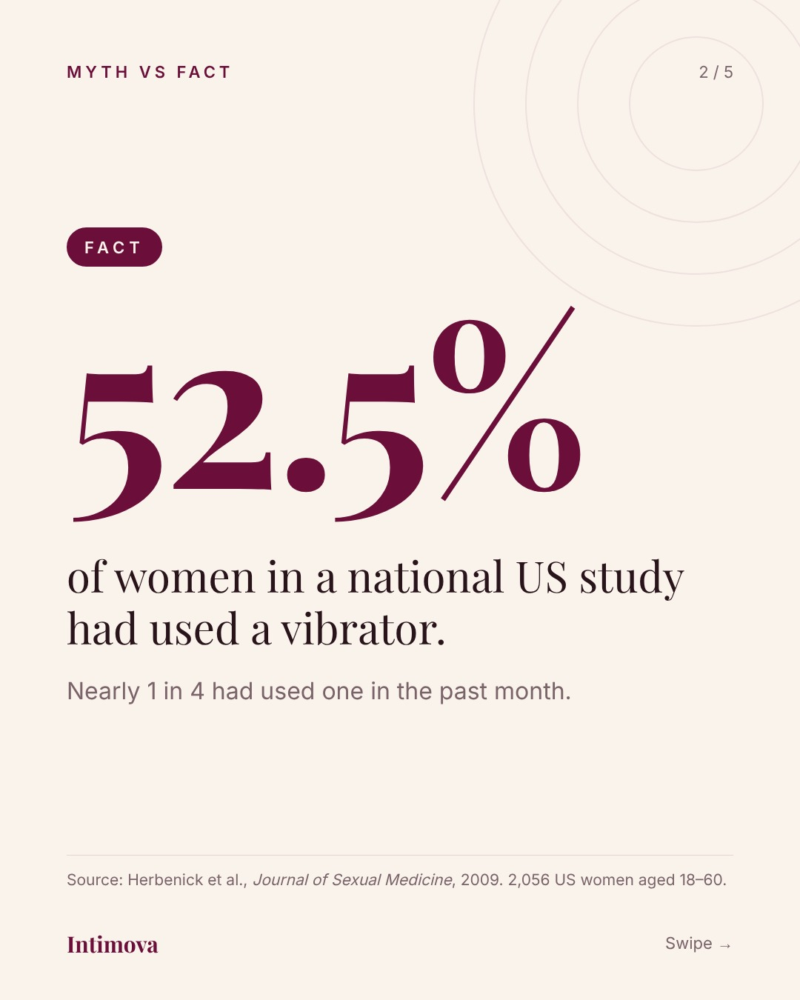
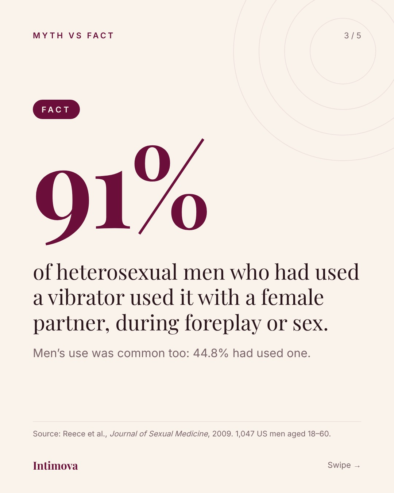
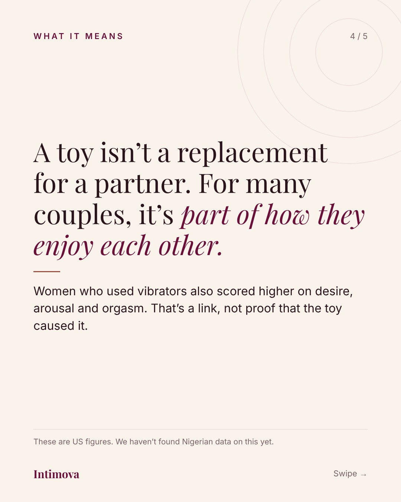
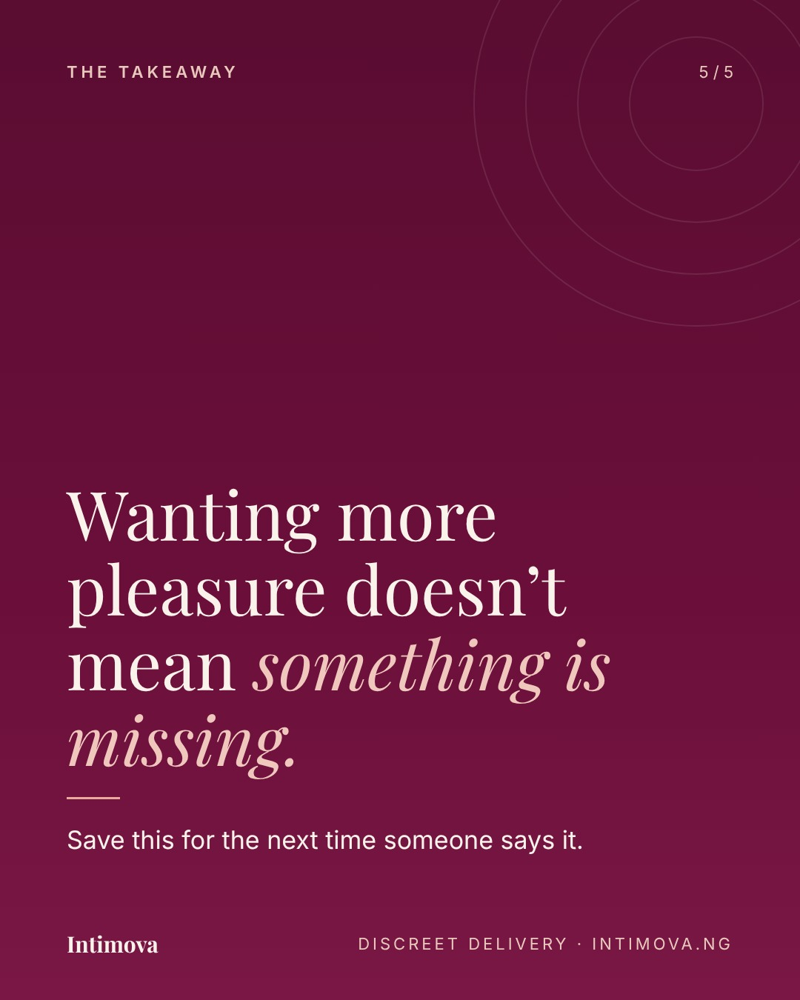
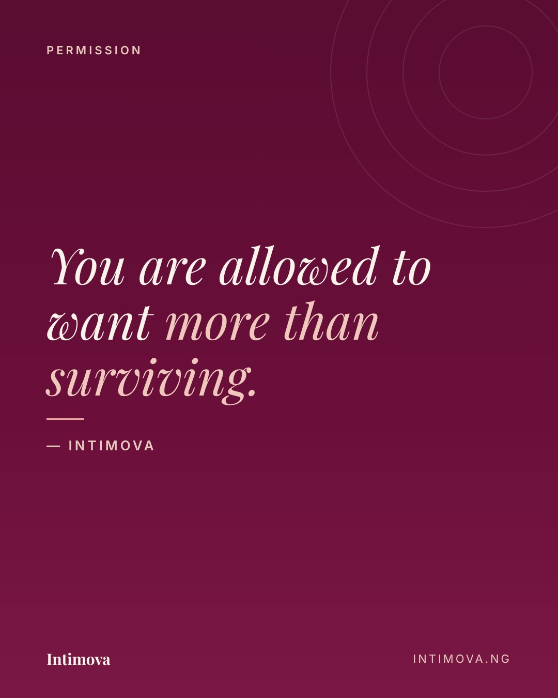

# Intimova: week of 2026-11-02

Merge this pull request to approve the week. Comment on anything you want changed.

| When (Lagos) | Post | Format | Platforms |
| --- | --- | --- | --- |
| Mon 2 Nov, 19:30 | 2026-11-02-myth-toys | carousel | instagram, facebook, x, tiktok |
| Wed 4 Nov, 19:30 | 2026-11-04-lily-part1 | reel | instagram, facebook, x, tiktok |
| Fri 6 Nov, 19:30 | 2026-11-06-quote-surviving | carousel | instagram, facebook, x, tiktok |

## Mon 2 Nov, 19:30 · 2026-11-02-myth-toys

    

**Instagram**

> Myth: sex toys are for people who can’t find a partner.
> 
> In a national US study, 52.5% of women had used a vibrator. And 91% of heterosexual men who had used one used it with a female partner. A toy isn’t a replacement for love. For many couples, it’s part of it.
> 
> Save this for the next time someone says it.
> 
> Sources: Herbenick et al. and Reece et al., Journal of Sexual Medicine, 2009. US adults aged 18–60. Both studies were funded by Church & Dwight Co.
> 
> #MythVsFact #SexualWellness #PleasureIsSelfCare #Relationships #Intimova

**X**

> Myth: sex toys are for people who can’t find a partner.
> 
> The research says otherwise. 👇
>
> ↳ > Sources: Herbenick et al. and Reece et al., Journal of Sexual Medicine, 2009. US adults aged 18–60.

**TikTok** · Myth vs fact: sex toys are for single people?

> Myth: sex toys are for people who can’t find a partner. The research says otherwise. Swipe to see the numbers.
> 
> Sources: Herbenick et al. and Reece et al., Journal of Sexual Medicine, 2009 (US adults aged 18–60).
> 
> #MythVsFact #SexualWellness #Relationships #Intimova

Safety: explicit no ✅ · health claim yes, sourced ✅ · clear faces no ✅

## Wed 4 Nov, 19:30 · 2026-11-04-lily-part1

[Watch the reel (89.2s)](../../public/2026-11-02/2-wed-lily-part1/reel.mp4)

**Instagram**

> She called him at 2am. On her anniversary. 🍷
> 
> Lily · Part 1. Seven years married, and her husband forgot again. So at 1:58 she called the one man who never once tried.
> 
> Part 2 drops next Wednesday. Follow so you don’t miss it.
> 
> Have you ever felt invisible in your own home? Tell us below. 👇
> 
> #IntimovaStories #LoveStory #RomanceReads #NaijaRomance #Relationships #SelfLove #Intimova

**X**

> She called him at 2am. On her anniversary. 🍷
> 
> Lily · Part 1. Part 2 next Wednesday.

**TikTok** · She called him at 2am. Lily · Part 1

> She called him at 2am. On her anniversary. 🍷 Lily · Part 1. Part 2 drops next Wednesday, follow so you don’t miss it. #IntimovaStories #BookTok #RomanceBooks #LoveStory #Intimova

Safety: explicit no ✅ · health claim none · clear faces no ✅

## Fri 6 Nov, 19:30 · 2026-11-06-quote-surviving

**Instagram**

> You are allowed to want more than surviving.
> 
> For everyone holding it together for everybody else: your own joy is not a luxury. Tag someone who needs to hear this today.
> 
> #Intimova #SelfLove #PleasureIsSelfCare #Wellbeing

**X**

> You are allowed to want more than surviving.

**TikTok** · You are allowed to want more.

> For everyone holding it together for everybody else: your own joy is not a luxury. #Intimova #SelfLove #Wellbeing

Safety: explicit no ✅ · health claim none · clear faces no ✅

---

### Needs your input: Sunday 8 Nov, product guide

The playbook's starter week ends with a product guide on Sunday. I haven't made it because I don't know which product to feature.
Reply on this pull request with:

1. The product name and its link on intimova.ng
2. Its price
3. Who it's for (beginners, couples, solo) and one thing customers like about it

I'll build the 5-slide guide (the problem, which tool fits, care and safe use, discreet delivery and Paystack, link) and add it to this week.

